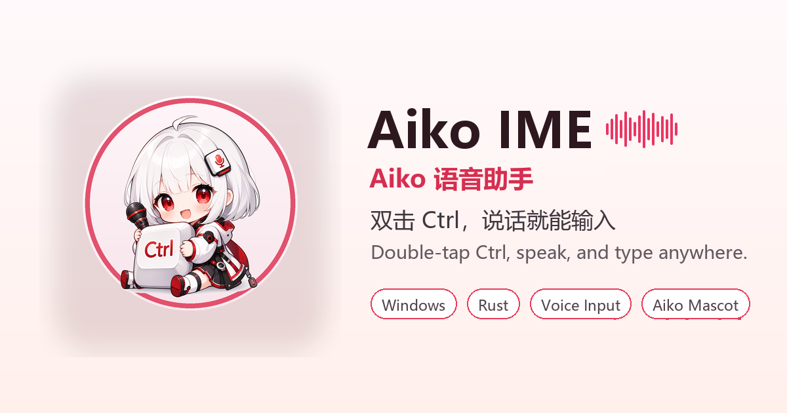
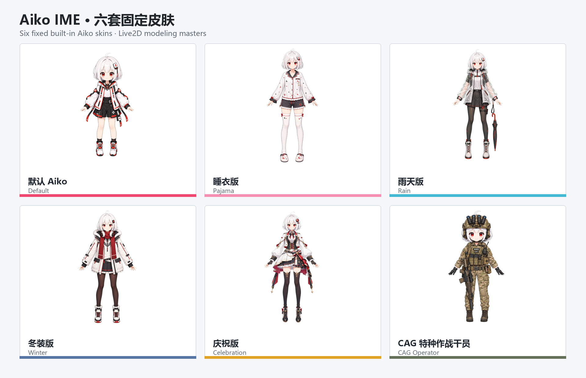

> [!IMPORTANT]
> **本项目已归档,不再维护。** 原因:Windows 端现已推出官方的豆包输入法,Aiko IME 已没有继续存在的必要。请直接使用官方豆包输入法。
>
> **This project is archived and no longer maintained.** Reason: the official Doubao IME is now available on Windows, so Aiko IME is no longer needed. Please use the official Doubao IME instead.

# Aiko IME



Aiko IME 是一款面向 Windows 的轻量语音输入工具，使用 Rust 编写。它通过全局热键开始录音，把麦克风音频流式发送到 ASR 后端，并通过 Win32 `SendInput` API 将识别结果输入到当前正在使用的应用里。

Aiko IME is a lightweight Windows voice input tool written in Rust. It listens for a global hotkey, records microphone audio, streams it to an ASR backend, and inserts recognized text into the currently focused application through the Win32 `SendInput` API.

本项目受 [EvanDbg/doubao-ime-win](https://github.com/EvanDbg/doubao-ime-win) 启发，并基于同类思路继续整理和改进：做一个小巧、便携、不需要安装完整输入法也能在 Windows 任意输入框里说话打字的工具。

This project is inspired by and derived from [EvanDbg/doubao-ime-win](https://github.com/EvanDbg/doubao-ime-win). It keeps the same practical idea: a small, portable dictation helper that can type anywhere on Windows without installing a full IME.

> 状态：Beta / 实验性项目。当前 ASR 后端使用非官方豆包语音输入协议；如果上游服务或协议发生变化，功能可能随时失效。
>
> Status: beta / experimental. The current ASR provider uses an unofficial Doubao voice-input protocol and may stop working if the upstream service or protocol changes.

> Cubism 状态：当前 v1.6.0 发布包提供的是 PNG 状态精灵和轻量动画，并未捆绑可直接发布的真正 Cubism 模型。`cubism-live2d` Cargo feature 目前提供 Core 动态加载、模型发现/校验和命令解析基础；最终 Native Framework 渲染适配器及 Aiko runtime 模型尚未完成，因此当前桌宠仍使用 PNG。
>
> Cubism status: the current v1.6.0 package ships PNG state sprites and lightweight animation, not a release-ready genuine Cubism model. The `cubism-live2d` Cargo feature currently provides Core dynamic loading, model discovery/validation, and command resolution foundations. The final Native Framework renderer adapter and Aiko runtime model are not complete, so the desktop pet still uses PNG rendering.

## 功能 / Features

- 全局触发：默认双击 `Ctrl` 开始或结束语音输入，也支持配置组合热键。
  Global trigger: double-tap `Ctrl` by default, with support for configurable combo hotkeys.
- 悬浮控制：录音时显示置顶小窗口，包含波形、确认和取消控制。
  Floating control: a small topmost HUD with recording waveform, confirm, and cancel controls.
- 系统托盘：可从托盘菜单开始、停止、打开设置或退出。
  System tray: start, stop, settings, and quit from the tray menu.
- Aiko 桌宠：可从托盘菜单显示或隐藏桌面小 Aiko；当前稳定路径使用 PNG 状态精灵实现轻量 Live2D 风格动画与抚摸反馈。
  Aiko desktop pet: show or hide the small desktop companion from the tray menu. The current stable path uses PNG state sprites for lightweight Live2D-style animation and petting feedback.
- 文本输入：识别结果会通过 Windows 原生输入事件插入到当前应用。
  Text insertion: recognized text is inserted into the active app using native Windows input events.
- 便携使用：发布版可以打包为包含 `aiko-ime.exe` 和 `config.toml` 的便携目录。
  Portable layout: release builds can be packaged as a folder with `aiko-ime.exe` and `config.toml`.
- 可选 AI 后处理：配置中保留了 OpenAI 兼容接口的后处理和翻译字段。
  Optional AI post-processing: configuration fields are present for OpenAI-compatible post-processing and translation.

## 更多 Aiko / More Aiko



当前美术库包含默认 Aiko 的正面建模母版、12 种表情与口型、头部角度表、动作表，
以及居家、雨天、冬装、庆祝和 CAG Operator 固定皮肤方案。

The art library now includes a front-facing modeling master, 12 expression and
mouth references, head-angle and motion sheets, plus fixed Cozy, Rain, Winter,
Festive, and CAG Operator skin concepts.

CAG Operator 版使用现代 Multicam、高切盔、四筒 GPNVG、全指手套和低轮廓
plate carrier。步枪通过枪带固定在胸前、枪口朝下，胸贴固定为 `AIKO / B RH-`；
不使用麦克风贴章或背景麦克风标志。

The CAG Operator skin uses modern Multicam equipment, a high-cut helmet,
four-tube GPNVG, full-finger gloves, and a low-profile plate carrier. Its rifle
is retained against the chest by a sling with the muzzle down, the chest patches
are fixed to `AIKO / B RH-`, and no microphone patch or background microphone
symbol is used.

完整美术目录和生成规范见 [`assets/aiko_art`](assets/aiko_art/README.md)。这些图片是
Cubism 建模参考，不是伪造的 `.moc3`。

See [`assets/aiko_art`](assets/aiko_art/README.md) for the complete art catalog
and generation notes. These images are Cubism modeling references, not fake
`.moc3` files.

## 版本亮点 / Version Highlights

### v1.6 可靠性与识别质量 / v1.6 Reliability And Recognition Quality

- 离线识别接入主流程：`asr.backend = "offline"` 会真正构建 sherpa-onnx provider 并走 PCM 通路；feature/DLL/模型缺失时弹窗说明并自动回退在线识别。
  Offline recognition is wired into the dictation flow: `asr.backend = "offline"` builds the sherpa-onnx provider over a PCM path, with an explained automatic fallback to online recognition when the feature build, DLL, or model is missing.
- 设置中选择的麦克风现已生效；找不到时回退系统默认。
  The microphone chosen in settings is now honored, falling back to the system default when missing.
- 重采样改为均值抽取 + 线性插值，Opus 改用 VOIP 模式 24kbps；移除会截断安静句首的硬噪声门。
  Resampling now uses averaging plus linear interpolation, Opus runs in VOIP mode at 24kbps, and the onset-chopping hard noise gate is gone.
- 注册/token/AI 请求带超时；WebSocket 错误与会话中断会上报；真实尾帧标记 `Last`。
  Registration, token, and AI requests carry timeouts; WebSocket errors and mid-session disconnects surface as errors; the genuine final audio frame is flagged `Last`.
- 确认停止会等待最终识别结果，取消会中断识别并撤回本次输入；音频采集线程加 generation 保护，快速切换/回退时不会把旧帧送进新会话。
  Confirm-stop waits for final recognition, while cancel interrupts recognition and removes text typed in the current session. Audio capture now uses generation guards so stale frames cannot leak into a new session during quick restarts or fallback.
- 修复退出卡顿、配置保存竞态（原子写入）、桌宠卡"倾听"状态、桌宠菜单与托盘状态不同步、多显示器位置越界等问题；双击 CapsLock 可用。
  Fixed the delayed quit, config save races (atomic writes), the pet sticking in "listening", pet-menu/tray desync, and off-screen restores on multi-monitor; double-tap CapsLock now works.
- UI 模式日志写入 exe 旁的 `aiko-ime.log.*` 滚动文件，release 版问题可排查。
  UI-mode logs now go to rolling `aiko-ime.log.*` files next to the executable, making release builds diagnosable.

### v1.5 发布与质量门禁 / v1.5 Release And Quality Gates

- CI 在 Windows 上依次执行 `cargo fmt`、`cargo clippy`、`cargo test`、静态链接 Release 构建、便携包校验和离线 smoke test。
  CI runs `cargo fmt`, `cargo clippy`, `cargo test`, a statically linked release build, portable package validation, and an offline smoke test on Windows.
- 桌宠升级为轻量 Live2D 风格：支持待机、倾听、处理中、成功、错误、困倦和被摸头开心等状态，并会跟随语音输入流程切换。
  The desktop pet now behaves like a lightweight Live2D-style companion with idle, listening, processing, success, error, sleepy, and petted states that follow the dictation flow.
- 新增多张 Aiko 状态素材，桌宠可点击开始/停止语音输入，也会保存拖动位置和尺寸。
  Added multiple Aiko state sprites. The pet can start/stop dictation from clicks and persists its dragged position and size.
- 便携包契约要求包含 `aiko-ime.exe`、`config.toml`、完整 `assets/`、`LICENSE`、`README.md`、`RELEASE_NOTES.md` 和 `VERSION.txt`。
  The portable package contract requires `aiko-ime.exe`, `config.toml`, the complete `assets/` tree, `LICENSE`, `README.md`, `RELEASE_NOTES.md`, and `VERSION.txt`.
- 新增仓库契约测试，覆盖双语发布文档、资源可解码性、配置模板、CI 步骤和 portable 布局。
  Repository contract tests cover bilingual release documentation, decodable assets, the config template, CI steps, and the portable layout.
- 这里的“Live2D 风格”指 PNG 精灵动画，不代表 v1.5.0 已包含真正 Cubism 模型或 Cubism SDK。
  Here, "Live2D-style" means PNG sprite animation; v1.5.0 does not include a genuine Cubism model or the Cubism SDK.

### v1.4 离线识别基础 / v1.4 Offline Recognition Foundation

- 增加在线/离线 ASR provider 契约，为 Doubao 在线后端和 sherpa-onnx 离线后端使用同一会话事件模型。
  Added an online/offline ASR provider contract so the Doubao online backend and sherpa-onnx offline backend can share one session event model.
- 增加 sherpa-onnx 模型发现、模型清单校验、运行库探测和中英文错误信息。
  Added sherpa-onnx model discovery, model manifest validation, runtime probing, and bilingual error messages.
- 默认便携包仍以在线识别为主；离线识别需要带 `sherpa-onnx` feature 的 Windows 构建、运行库 DLL 和模型目录。
  The default portable package still targets online recognition; offline recognition requires a Windows build with the `sherpa-onnx` feature, runtime DLLs, and a model directory.

### v1.3 设置中心与本地体验 / v1.3 Settings And Local UX

- 新增原生 Windows 设置中心，可从托盘打开并编辑热键、悬浮控件、桌宠、ASR、AI 和自定义词典设置。
  Added a native Windows settings center from the tray for hotkey, floating control, desktop pet, ASR, AI, and custom vocabulary settings.
- 配置模板补充开机自启动、历史记录开关、麦克风选择、在线/离线 ASR 字段和桌宠尺寸等选项。
  The config template now includes startup, history logging, microphone selection, online/offline ASR fields, and desktop pet size options.
- 增加单实例保护，重复启动会提示使用已有托盘实例，避免多个录音控制器同时运行。
  Added a single-instance guard so duplicate launches point users back to the existing tray instance instead of running multiple recording controllers.

## 下载 / Download

从 GitHub Releases 下载便携压缩包，解压后运行：

Download a portable archive from GitHub Releases, unzip it, and run:

```powershell
.\aiko-ime.exe
```

首次启动时，Aiko IME 会在可执行文件旁边创建本地运行文件，例如 `config.toml` 和 `credentials.json`。这些文件通常包含本机配置或临时凭据，因此不会提交到仓库。

On first launch, Aiko IME creates local runtime files next to the executable, including `config.toml` and `credentials.json`. These files are intentionally not committed to the repository.

## 使用方法 / Usage

1. 运行 `aiko-ime.exe`。
   Run `aiko-ime.exe`.
2. 双击 `Ctrl` 开始语音输入。
   Double-tap `Ctrl` to start voice input.
3. 对着麦克风说话。
   Speak into the microphone.
4. 再次双击 `Ctrl`，或点击确认按钮，结束录音并保留已经输入的文字。
   Double-tap `Ctrl` again, or click the confirm button, to stop and keep the inserted text.
5. 点击取消按钮可以结束录音，并移除本次会话已经输入的文字。
   Click the cancel button to stop and remove text inserted during the current session.

悬浮窗口可以拖动，位置会保存到 `config.toml`。

The floating window can be dragged. Its position is saved in `config.toml`.

桌宠可以从托盘菜单的 `显示/隐藏桌宠` 开关控制，也可以在配置文件中设置默认状态。

The desktop pet can be controlled from the tray menu item `显示/隐藏桌宠`, or configured as enabled/disabled by default.

### Cubism 与 PNG 回退 / Cubism And PNG Fallback

当前仓库把可用的 PNG 路径与尚在建设的 Cubism 集成基础明确分开：

The repository clearly separates the usable PNG path from the Cubism integration foundation still under construction:

- **PNG fallback**：仓库和当前 portable 包已包含，可在没有 Cubism SDK、runtime 或模型时工作。
  **PNG fallback:** included in the repository and current portable package; works without the Cubism SDK, runtime, or model.
- **Cubism 运行时基础 / Cubism runtime foundation**：实验性、feature-gated，覆盖 Core 动态加载、模型发现/校验和状态命令解析，但尚未完成桌宠窗口的 Native Framework 渲染适配。
  **Cubism runtime foundation:** experimental and feature-gated. It covers Core dynamic loading, model discovery/validation, and state-command resolution, but the Native Framework rendering adapter for the desktop-pet window is not complete.
- **真正 Cubism 交付 / Genuine Cubism delivery**：还需要合法的 `*.model3.json`、`.moc3`、纹理、motion/expression/physics 文件、兼容 SDK/runtime，以及完成并验证的渲染适配器。
  **Genuine Cubism delivery:** still requires valid `*.model3.json`, `.moc3`, textures, motion/expression/physics files, a compatible SDK/runtime, and a completed, verified rendering adapter.
- 仓库中的制作与验收契约位于 `assets/live2d`；当前 runtime 阶段明确标记为 `missing`，没有伪造 `.moc3`。未来通过严格检查的 runtime 导出包才会在 portable 中映射到 `models/live2d`。
  The production and acceptance contract lives under `assets/live2d`. Its runtime stage is explicitly marked `missing`, with no fake `.moc3`. A future runtime export that passes strict validation will be mapped to `models/live2d` in the portable package.

## 配置 / Configuration

从源码运行时，可以把 `config.toml.example` 复制为 `config.toml`；使用便携版时，直接编辑可执行文件旁边生成的 `config.toml`。

When running from source, copy `config.toml.example` to `config.toml`. When using the portable build, edit the generated `config.toml` next to the executable.

```toml
[hotkey]
mode = "double_tap"
combo_key = "Ctrl+Shift+V"
double_tap_key = "Ctrl"
double_tap_interval = 300

[floating_button]
enabled = true
position_x = 100
position_y = 100

[desktop_pet]
enabled = true
position_x = -1
position_y = -1
size = 160
renderer = "cubism"
live2d_model_dir = "models/live2d"
target_fps = 30
```

`renderer = "cubism"` 是面向后续集成的偏好配置，不代表当前已启用真正 Cubism 渲染。当前缺少 runtime 模型或最终渲染适配时，桌宠使用 PNG fallback。可显式设置 `renderer = "png"` 固定使用 PNG。

`renderer = "cubism"` is a preference for the continuing integration; it does not mean genuine Cubism rendering is currently active. The desktop pet uses PNG fallback while the runtime model or final renderer adapter is unavailable. Set `renderer = "png"` to force PNG rendering.

如果想使用组合键，而不是双击 `Ctrl`：

To use a combo hotkey instead of double-tap `Ctrl`:

```toml
[hotkey]
mode = "combo"
combo_key = "Ctrl+Shift+V"
```

## 从源码构建 / Build From Source

构建要求 / Requirements:

- Windows 10/11 x64
- Rust stable
- Visual Studio Build Tools 2022，并安装 Desktop development with C++
  Visual Studio Build Tools 2022 with Desktop development with C++
- CMake
- Protocol Buffers 编译器 / Protocol Buffers compiler (`protoc`)

构建 / Build:

```powershell
git clone <repo-url>
cd aiko-ime

$env:PROTOC = "C:\path\to\protoc.exe"
cargo build --release
```

构建实验性 Cubism 运行时基础 / Build the experimental Cubism runtime foundation:

```powershell
cargo build --release --features cubism-live2d
```

这只启用 Core/模型加载与命令解析基础，并不会生成或捆绑模型，也不会附带 Live2D Cubism SDK，更不代表桌宠渲染适配已经完成。当前应用仍使用 PNG fallback。

This enables the Core/model-loading and command-resolution foundation only. It does not create or bundle a model, redistribute the Live2D Cubism SDK, or imply that the desktop-pet rendering adapter is complete. The current application still uses PNG fallback.

打包便携版 / Portable package:

```powershell
$env:PROTOC = "C:\path\to\protoc.exe"
.\scripts\build-portable.ps1
```

便携包会输出到 `dist\aiko-ime-portable`，并生成
`dist\aiko-ime-v<version>-portable.zip` 和对应的 SHA-256 校验文件。

The portable package is written to `dist\aiko-ime-portable`, with the archive and
SHA-256 checksum at `dist\aiko-ime-v<version>-portable.zip*`.

`.omc/`, `target/`, the local `dist/` workspace, and the source-tree `config.toml` are local
build/runtime state. GitHub Releases should publish only the validated portable ZIP and checksum,
not those working directories or local config files.

## 项目结构 / Architecture

- `src/main.rs`：UI 模式和命令行测试模式入口。
  UI mode and CLI test mode entry points.
- `src/business/hotkey_manager.rs`：全局热键和双击修饰键检测。
  Global hotkey and double-tap modifier detection.
- `src/business/voice_controller.rs`：录音、识别、文本插入的会话协调。
  Recording session orchestration.
- `src/audio/capture.rs`：麦克风采集和 Opus 音频帧生成。
  Microphone capture and Opus audio frame generation.
- `src/asr/`：设备注册、ASR 协议和 WebSocket 客户端。
  Device registration, ASR protocol, and WebSocket client.
- `src/business/text_inserter.rs`：Win32 文本插入。
  Win32 text insertion.
- `src/ui/`：系统托盘、悬浮窗口和桌宠窗口。
  System tray, floating window, and desktop pet window.
- `assets/`：Aiko 图标、托盘图标、README 展示图和桌宠素材。
  Aiko app icon, tray icon, README showcase image, and desktop pet assets.

## ASR 服务说明 / Notes On The ASR Provider

当前后端实现的是非官方豆包语音输入协议，适合学习、实验和自用，但它不是稳定的公开 API。

The current backend implements an unofficial Doubao voice-input protocol. This is useful for experimentation, but it is not a stable public API.

已知限制 / Known implications:

- 服务端协议可能随时变化，也可能拒绝请求。
  The service may change or reject requests at any time.
- 需要联网使用。
  Network access is required.
- 本项目与字节跳动、豆包或任何官方豆包产品没有关联。
  The project is not affiliated with ByteDance, Doubao, or any official Doubao product.
- 不建议把当前 ASR 后端用于关键生产工作流。
  Do not rely on this provider for critical production workflows.

仓库包含 `sherpa-onnx` 离线识别支持：provider 契约、模型发现、运行库探测已经接入语音控制器，`asr.backend = "offline"` 时会优先尝试离线识别。默认便携版不带 `sherpa-onnx` feature、运行库 DLL 和模型包，此时应用会提示原因并自动回退在线 Doubao 后端。

The repository includes `sherpa-onnx` offline recognition support. The provider contract, model discovery, and runtime probing are wired into the voice controller, and `asr.backend = "offline"` attempts offline recognition first. The default portable build ships without the `sherpa-onnx` feature, runtime DLLs, and model package; in that case the app explains why and falls back to the online Doubao backend automatically.

## 测试与质量门禁 / Testing And Quality Gates

提交前运行完整质量门禁：

Run the complete quality gate before submitting a change:

```powershell
$env:PROTOC = "C:\path\to\protoc.exe"
cargo fmt --all -- --check
cargo clippy --locked --all-targets --all-features
cargo test --locked --all-targets
.\scripts\Test-CubismBuildMatrix.ps1
.\scripts\Test-Live2DAssets.ps1
cargo build --locked --release --target x86_64-pc-windows-msvc
.\scripts\build-portable.ps1 -SkipBuild
$version = (Select-String Cargo.toml '^version\s*=\s*"([^"]+)"$').Matches[0].Groups[1].Value
.\scripts\Test-WindowsSmoke.ps1 `
  -BinaryPath "dist\aiko-ime-portable\aiko-ime.exe" `
  -PackagePath "dist\aiko-ime-v$version-portable.zip"
```

Windows smoke test 不会访问豆包服务、录制真实麦克风或向当前窗口输入文字。它验证
Release EXE、单实例保护契约、热键状态机关键状态、Win32 窗口类和完整资源树。

The Windows smoke test does not contact Doubao, capture a real microphone, or type
into the active window. It validates the release EXE, the single-instance contract,
hotkey state markers, Win32 window classes, and the complete packaged asset tree.

`Test-CubismBuildMatrix.ps1` 会自动发现 Cubism/Live2D Cargo feature，清除常见 SDK 路径环境变量，并验证默认构建、feature 构建和缺模型回退。`Test-Live2DAssets.ps1` 验证模型资产契约；没有真正模型时，PNG fallback 仍是合法且受测试覆盖的发布状态。

`Test-CubismBuildMatrix.ps1` discovers the Cubism/Live2D Cargo feature, clears common SDK path variables, and verifies the default build, feature build, and missing-model fallback. `Test-Live2DAssets.ps1` validates the model asset contract; when no genuine model is present, PNG fallback remains a valid and tested release state.

对于较新的 CMake 版本，仓库在 `.cargo/config.toml` 中设置了 `CMAKE_POLICY_VERSION_MINIMUM=3.5`，用于保持内置 Opus 依赖可构建。

For recent CMake versions, the repository sets `CMAKE_POLICY_VERSION_MINIMUM=3.5` in `.cargo/config.toml` to keep the bundled Opus dependency buildable.

## 发布流程 / Release Process

1. 确保 `Cargo.toml` 版本号、Git 标签和 `RELEASE_NOTES.md` 内容一致。
   Keep the `Cargo.toml` version, Git tag, and `RELEASE_NOTES.md` in sync.
2. 在干净工作树运行上述完整质量门禁。
   Run the complete quality gate above from a clean worktree.
3. 创建 `v<version>` 标签并推送。GitHub Actions 会重新执行全部检查。
   Create and push a `v<version>` tag. GitHub Actions reruns every check.
4. CI 只发布通过结构校验的便携 ZIP 和 SHA-256 文件。ZIP 包含
   `aiko-ime.exe`、`config.toml`、`README.md`、`RELEASE_NOTES.md`、`LICENSE`、
   `VERSION.txt`、`docs/LIVE2D_MODELING.md` 以及完整的嵌套 `assets/` 目录；
   只有 `assets/live2d/aiko/runtime` 被标记为 `ready` 且通过严格检查时才附带
   `models/live2d`。
   `.omc/`、`target/`、本地 `dist/` 工作区和源码树 `config.toml` 不作为 GitHub
   或 Release 附件发布。
   CI publishes only a validated portable ZIP and SHA-256 file. The ZIP contains
   `aiko-ime.exe`, `config.toml`, `README.md`, `RELEASE_NOTES.md`, `LICENSE`,
   `VERSION.txt`, `docs/LIVE2D_MODELING.md`, and the complete nested `assets/` tree.
   It includes `models/live2d` only when `assets/live2d/aiko/runtime` is marked
   `ready` and passes strict validation.

## 致谢 / Credits

- [EvanDbg/doubao-ime-win](https://github.com/EvanDbg/doubao-ime-win)：启发本项目的原 Windows 豆包语音输入项目。
  The original Windows Doubao voice input project that inspired this project.
- [doubaoime-asr](https://github.com/starccy/doubaoime-asr)：上游项目提到的协议参考。
  Protocol reference mentioned by the upstream project.
- `cpal`、`opus-rs`、`tokio-tungstenite`、`tray-icon` 和 Rust Windows bindings。
  `cpal`, `opus-rs`, `tokio-tungstenite`, `tray-icon`, and the Rust Windows bindings.

## 许可证 / License

MIT。详见 `LICENSE`。

MIT. See `LICENSE`.
